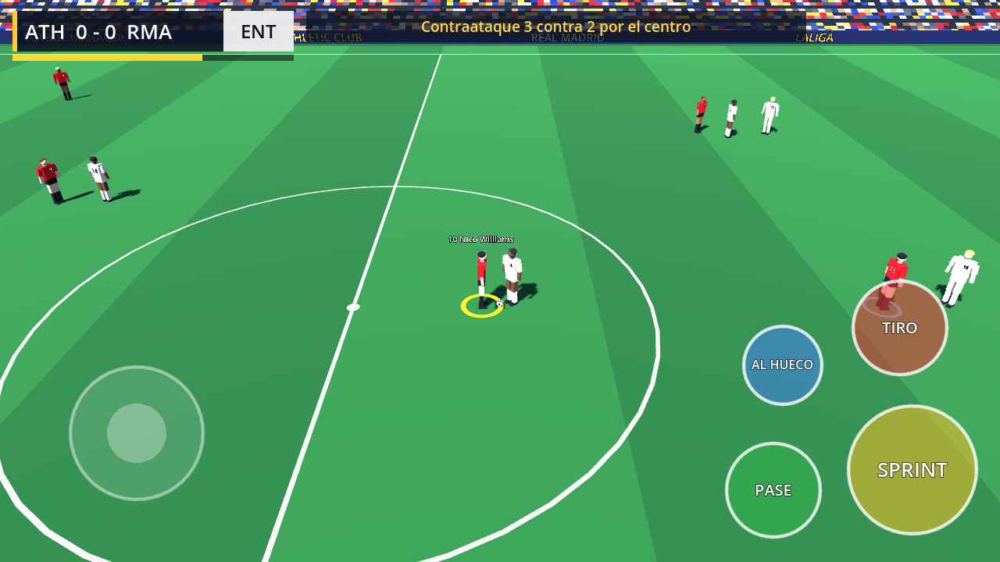

# Fútbol Mánager (versión 0.4)

Juego de fútbol para Android: eres el **entrenador** y eliges el once, la formación y los cambios. El partido se simula minuto a minuto y, cuando llega una **jugada clave**, la juegas tú en 3D: atacar, defender, un tiro libre, un penal o un córner.

Hecho con [Godot 4.3](https://godotengine.org) (gratis y de código abierto). Es para uso personal y no se publica en ninguna tienda.



## Novedades de la 0.4

- **Pase al hueco de verdad**: el balón va al espacio por delante del compañero, hacia la portería, y llega frenando justo cuando él llega corriendo.
- **Pase corto**: va al pie con la fuerza justa, y es más difícil de cortar si va tenso.
- **Recibir en carrera**: al controlar, el jugador sigue corriendo en lugar de frenar en seco y tiene un instante antes de que puedan quitársela.
- **Proteger el balón**: el jugador lo cubre con el cuerpo, apartándolo del rival más cercano. Las entradas por la espalda fallan más.
- **Portero como en la vida real**: se ajusta con pasos laterales, se lanza en plancha en el momento justo, a ras de suelo o a la escuadra, y se queda tendido en el suelo. Los tiros a la escuadra los desvía a córner.
- **Defensa**: con **PRESIÓN** tu jugador persigue al rival, mete la pierna al llegar y corre a cortar los pases del rival. El control pasa solo al defensor más cercano a la jugada.

## Novedades de la 0.3

- **Plantillas reales de LaLiga 2026/27**: los 20 equipos de esta temporada (con Racing, Deportivo y Málaga) con sus jugadores y dorsales actuales.
- **11 contra 11** en todas las jugadas: el resto del equipo mantiene la forma de su formación, marca y se desmarca.
- **Pases arreglados**: el compañero que va a recibir se marca con un **aro azul**. Al pasar, el receptor va solo a por el balón aunque sigas tocando el joystick.
- **Juego más pausado y realista**: jugadores más lentos, con inercia al acelerar y girar, y jugadas con más tiempo para pensar.
- **Nueva forma de correr**: piernas con rodillas, brazos con codos y una zancada que se ajusta a la velocidad.
- **SPRINT es el botón más grande**, abajo a la derecha.

## Instalarlo en tu Android

1. Descarga [`builds/futbol-manager.apk`](builds/futbol-manager.apk) en el teléfono. En GitHub, abre el archivo y toca **Download** o **View raw**.
2. Ábrelo y permite **instalar apps desconocidas** solo para el navegador o la app de archivos.
3. Si ya tenías la versión anterior, se actualiza encima.
4. Si sale un aviso de Play Protect, elige **Instalar de todas formas**; aparece porque la app no viene de la tienda.

Requisitos: Android 7 o superior con procesador de 64 bits.

## Modos de juego

| Modo | Qué es |
|---|---|
| **Partido rápido** | Eliges tu equipo y el rival, ajustas la alineación y juegas un partido. |
| **Modo carrera** | Llevas un club de LaLiga durante 38 jornadas: alineación, entrenamiento semanal, clasificación (3, 1 y 0 puntos) y calendario. Se guarda solo. |
| **Entrenamiento** | Practicas cualquier tipo de jugada del catálogo cuantas veces quieras. |

## Cómo funciona un partido

1. **Alineación**: elige una formación (4-3-3, 4-4-2, 4-2-3-1, 3-5-2 o 5-3-2) y toca dos jugadores para intercambiarlos. Un jugador fuera de su posición rinde menos (borde rojo).
2. **Simulación**: el partido avanza minuto a minuto con comentarios, estadísticas y la energía de tus jugadores. Puedes cambiar la velocidad, pausar y hacer hasta 5 cambios.
3. **Jugadas clave**: el juego elige una de las **110 jugadas** según lo que pasa en el partido: si tu equipo es rápido salen más contraataques; si vas perdiendo, más ataques en la frontal; si el rival es veloz, más contras en tu contra. Nunca repite una jugada en el mismo partido. Puedes **jugarla** o **simularla**.
4. **Final**: 3 puntos por victoria, 1 por empate y 0 por derrota. El ánimo sube o baja según el resultado.

### Los atributos importan

Cada jugador tiene **velocidad, pase, tiro, defensa, portería, tiro libre y resistencia**, además de **energía** (baja durante el partido y se recupera entre jornadas) y **ánimo**. Ambos afectan a lo que rinde.

- Un delantero rápido deja atrás a un central lento.
- Un buen tirador pone el balón entre los tres palos desde lejos; uno malo la manda a la grada.
- El portero **siempre reacciona**. Que la pare depende de su habilidad, de la velocidad del tiro y de lo ajustado que vaya al palo.
- En el tiro libre cuenta el atributo **TL** del lanzador.

### Las 110 jugadas

| Tipo | Cantidad |
|---|---|
| Contraataques (2 contra 1, 3 contra 2, 4 contra 3; por izquierda, centro o derecha) | 18 |
| Ataques en la frontal del área | 9 |
| Mano a mano | 6 |
| Desbordes por banda con centro | 8 |
| Rechaces del portero | 4 |
| Córners a favor (primer palo, punto de penal, segundo palo) | 6 |
| Tiros libres directos (5 distancias x 5 ángulos) | 25 |
| Penales a favor | 2 |
| Penal en contra (eres el portero) | 1 |
| Defender contraataques | 18 |
| Defender la frontal | 6 |
| Defender desbordes por banda | 4 |
| Defender un mano a mano | 3 |

## Controles

| Botón | En ataque | En defensa |
|---|---|---|
| Joystick (mitad izquierda) | Mover | Mover |
| Amarillo grande (abajo a la derecha) | **SPRINT** | **SPRINT** |
| Rojo (arriba) | **TIRO**: mantén para cargar y suelta. Cerca de un balón aéreo hace un **cabezazo** | **BARRIDA** |
| Verde | **PASE** al compañero marcado con el aro azul. Desde la banda hacia el área sale un **centro** | **CAMBIAR** de jugador |
| Azul | **AL HUECO**: pase al espacio | **PRESIÓN**: mantén y persigue al rival |

**Tiro libre** (cámara detrás del balón):

1. Mueve la mira amarilla con el joystick.
2. Elige el efecto con **< EFECTO** y **EFECTO >**.
3. Cambia de lanzador con **LANZADOR**.
4. Mantén **TIRO** para cargar la potencia y suelta. Si apuntas alto, el balón sube para superar la barrera; si pasas de la marca blanca, se va por arriba.

**Penal en contra**: eliges **IZQUIERDA**, **CENTRO** o **DERECHA** antes de que patee el rival.

## Estructura

```
futbol/
├── data/                  plantillas reales de LaLiga 2026/27
├── tools/build_squads.py  genera los datos de los jugadores
├── scenes/                menú, carrera, simulación y jugada 3D
├── scripts/
│   ├── game_data.gd       LaLiga, jugadores, alineaciones, liga y guardado
│   ├── match_sim.gd       simulación minuto a minuto
│   ├── jugadas.gd         catálogo de 110 jugadas y elección según el partido
│   ├── match.gd           jugada en 3D: IA, pases, tiros, portero, balón parado
│   ├── player.gd          futbolista low-poly animado por código
│   ├── ball.gd            física del balón (bote, rodado, efecto, postes, red)
│   ├── stadium.gd         estadio
│   ├── hud.gd             joystick y botones táctiles
│   ├── menu.gd            menú principal, partido rápido, carrera y entrenamiento
│   ├── career.gd          centro del modo carrera
│   ├── sim.gd             pantalla del partido simulado
│   ├── lineup_panel.gd    editor de alineación y cambios
│   └── ui.gd, mesh_util.gd
├── tests/
│   ├── autotest.gd        juega las 110 jugadas, simula partidos y una temporada entera
│   ├── mecanicas.gd       prueba portero en tiros lejanos, pases, recepción y presión
│   └── shot.gd            capturas de todas las pantallas
└── builds/                APK compilado
```

## Plantillas y valoraciones

- **Jugadores y dorsales**: sacados de Wikipedia (plantillas actualizadas entre septiembre y noviembre de 2026) y guardados en `data/plantillas_wikipedia_2026_27.json`.
- **Valoraciones**: son **aproximadas**, al estilo de los videojuegos de fútbol, porque Wikipedia no trae estadísticas. Unos 400 jugadores tienen valoración propia; los canteranos y suplentes poco conocidos tienen una estimada según el nivel del equipo.
- Para corregir a alguien, edita la tabla `RATINGS` de `tools/build_squads.py` y ejecuta `python3 tools/build_squads.py`. Se regenera `data/laliga_2026_27.json`.
- Las partidas de carrera de la 0.2 (con jugadores inventados) no se cargan; empieza una nueva.

## Compilar

```bash
godot --headless -s tests/autotest.gd   # prueba automática
GODOT=godot ./build_apk.sh              # APK (plantillas de Godot 4.3 + Android SDK)
```

## Próximos pasos

- Animaciones de Mixamo para que los jugadores se muevan de forma realista.
- Sonido: público, silbato y gol.
- Más jugadas: defender córners y tiros libres en contra.
- Mercado de fichajes, lesiones, tarjetas y más ligas.
